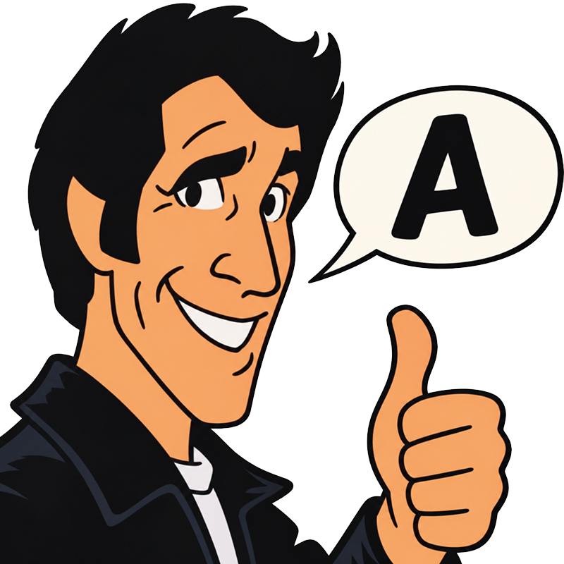

<!--
Other text editors want you to type "Ayyyyy!" but
The Fonz knows when enough is enough!
-->
𝖮𝗍𝗁𝖾𝗋 𝗍𝖾𝗑𝗍 𝖾𝖽𝗂𝗍𝗈𝗋𝗌 𝗐𝖺𝗇𝗍 𝗒𝗈𝗎 𝗍𝗈 𝗍𝗒𝗉𝖾 "𝖠𝗒𝗒𝗒𝗒𝗒!" 𝖻𝗎𝗍
𝖳𝗁𝖾 𝖥𝗈𝗇𝗓 𝗄𝗇𝗈𝗐𝗌 𝗐𝗁𝖾𝗇 𝖾𝗇𝗈𝗎𝗀𝗁 𝗂𝗌 𝖾𝗇𝗈𝗎𝗀𝗁!

<!--
I believe it was Fonzie himself that said "Brevity is the
Soul of Wit". To that end The Fonz features a usable work
space of exactly one byte. "You talk too much, 𝖱𝖺𝗅𝗉𝗁 Malph"
indeed!
-->
𝖨 𝖻𝖾𝗅𝗂𝖾𝗏𝖾 𝗂𝗍 𝗐𝖺𝗌 𝖥𝗈𝗇𝗓𝗂𝖾 𝗁𝗂𝗆𝗌𝖾𝗅𝖿 𝗍𝗁𝖺𝗍 𝗌𝖺𝗂𝖽 "𝖡𝗋𝖾𝗏𝗂𝗍𝗒 𝗂𝗌 𝗍𝗁𝖾
𝖲𝗈𝗎𝗅 𝗈𝖿 𝖶𝗂𝗍". 𝖳𝗈 𝗍𝗁𝖺𝗍 𝖾𝗇𝖽 𝖳𝗁𝖾 𝖥𝗈𝗇𝗓 𝖿𝖾𝖺𝗍𝗎𝗋𝖾𝗌 𝖺 𝗎𝗌𝖺𝖻𝗅𝖾 𝗐𝗈𝗋𝗄
𝗌𝗉𝖺𝖼𝖾 𝗈𝖿 𝖾𝗑𝖺𝖼𝗍𝗅𝗒 𝗈𝗇𝖾 𝖻𝗒𝗍𝖾. "𝖸𝗈𝗎 𝗍𝖺𝗅𝗄 𝗍𝗈𝗈 𝗆𝗎𝖼𝗁, 𝖱𝖺𝗅𝗉𝖿 𝖬𝖺𝗅𝗉𝗁"
𝗂𝗇𝖽𝖾𝖾𝖽!
